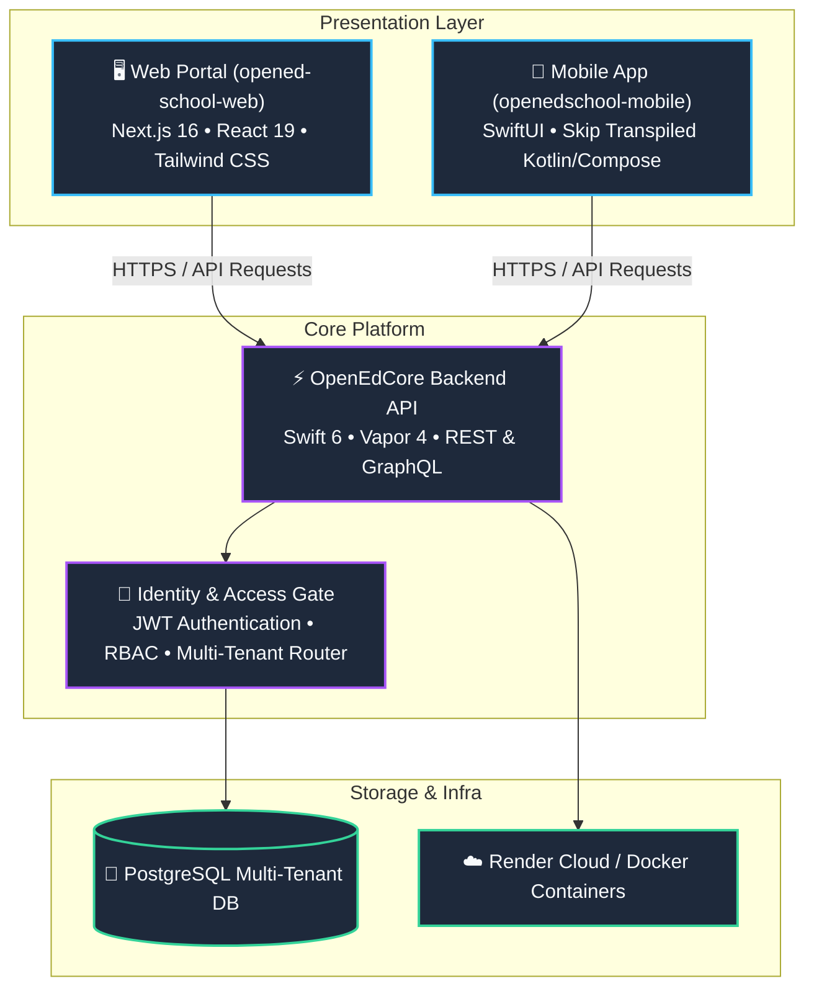

  

  <strong>The Full-Stack Next-Generation School & College Management Ecosystem</strong> 
  Powered by Vapor Swift Server & Mobile-First Multiplatform Tech

  
  
  
  

---

## 🏛️ Executive Summary & Value Proposition

**OpenEdCore** is an all-in-one, modern cloud operating platform engineered to replace fragmented legacy ERPs in modern educational institutions, K-12 school networks, and multi-campus universities.

Unlike obsolete 2000s-era monolithic school software, OpenEdCore delivers:
- **Unified Fullstack Ecosystem**: Seamless synchronization across High-Performance Swift Backends, React 19 Web Dashboards, and Native iOS / Android Mobile Apps.
- **Enterprise Multi-Tenancy**: Zero-leakage database isolation, tenant-specific routing (`X-Tenant-Slug`), and custom domain mapping for multi-school conglomerates.
- **Real-Time Campus Mobility**: Instant push notifications, digital student ID cards with secure QR validation, live attendance check-in, and interactive class timetable rosters.
- **Military-Grade Security**: Automated GitHub CodeQL static vulnerability scanning, OWASP-compliant access gates, and role-based cryptographic access control (Super Admin, Principal, Teacher, Student, Parent).

---

## 🚀 The Three Pillars of the Ecosystem

---

## 📦 Core Repositories

| Repository | Role & Stack | Key Features | CI/CD & Security |
| :--- | :--- | :--- | :--- |
| [**`OpenEdCore`**](https://github.com/OpenEdCore-Technologies/OpenEdCore) | **High-Concurrency Backend API** `Swift 6` • `Vapor 4` • `PostgreSQL` | Multi-tenant tenant resolution, academic scheduling, gate security, attendance verification |   |
| [**`opened-school-web`**](https://github.com/OpenEdCore-Technologies/opened-school-web) | **Administrative Web Portal** `Next.js 16` • `React 19` • `TypeScript` | Institutional analytics, admissions funnel, student rosters, real-time timetable matrix |   |
| [**`openedschool-mobile`**](https://github.com/OpenEdCore-Technologies/openedschool-mobile) | **Native iOS & Android Client** `SwiftUI` • `Skip Tools` • `Jetpack Compose` | Single Swift codebase transpiling to native Android Jetpack Compose, offline-first timetable |   |

---

## 🌟 Key Platform Capabilities

### 1. Multi-Tenant School Virtualization
- Complete logical isolation per school brand, academic branch, or university campus.
- Automated tenant resolution via subdomain (`greenwood.openedschool.com`), custom domains, or HTTP headers (`X-Tenant-Slug`).

### 2. Interactive Academic Scheduling & Timetables
- Drag-and-drop timetable generator preventing instructor double-booking and room collisions.
- Instant timetable synchronization to students' and teachers' mobile devices.

### 3. Smart Access Gate & Campus Security
- QR-code digital ID card rendering with cryptographic tamper verification.
- Real-time parent alerts and notifications when students enter or leave campus facilities.

### 4. Fully Automated CI/CD & Static Security Analysis
- Every code check-in is compiled, tested, and analyzed with **GitHub CodeQL** across Swift and TypeScript to eliminate vulnerabilities before production deployment.

---

## 📈 Roadmap & Commercial Milestones

- [x] Multi-tenant core data models & database migration infrastructure
- [x] Web Portal Admin & Principal admissions management dashboard
- [x] Cross-platform iOS & Android mobile application with Skip
- [x] Automated CodeQL Advanced Security Scanning across all tiers
- [ ] Enterprise Stripe / Razorpay tuition fee invoicing & auto-collection
- [ ] Real-time GPS bus transport tracking & geofencing integration
- [ ] White-label multi-campus custom branding provisioning for partner school networks

---

  Built with precision for the future of education • © 2026 OpenEdCore Technologies

